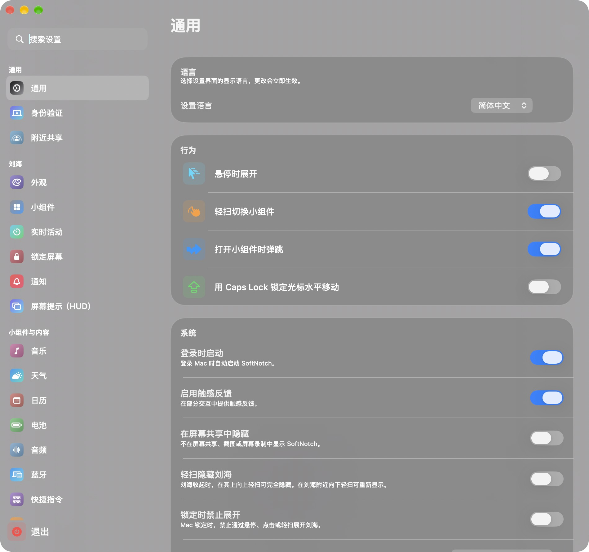

# SoftNotch

Walter Luo 的个人 macOS 刘海工具，基于 [Sapphire](https://github.com/cshariq/Sapphire) 公开源码及本地修改构建。保留原有 SwiftUI / AppKit 界面、动画和已实现功能，使用独立的应用身份与数据目录。

当前源码版本 **1.0.0**，构建号 **20261016.1**，构建脚本面向 **Apple Silicon / arm64**。本轮更新同步源码与文档，未发布新的二进制 Release，也未变更版本号。

## 功能

- **刘海面板**：保留音乐控制、日历、天气、文件暂存、窗口贴靠、蓝牙及电池状态等公开源码实现。
- **快捷截图**：按钮位于“钉在桌面”左侧；框选区域后写入剪贴板，可用 `Command + V` 粘贴，`Esc` 取消。
- **日历回到今天**：每次重新展开刘海面板，按当前本地日期选中今天；面板持续打开时仍可浏览其他日期。
- **中英文设置**：默认简体中文，可切换 English。
- **独立运行身份**：独立的主程序、辅助程序、偏好设置、文件目录和钥匙串服务；上游自动更新、Google Analytics 与 Crashlytics 收集已禁用。

功能清单描述源码包含的实现。在线服务、硬件集成和系统权限相关功能需要分别验证；公开源码缺失的账户、订阅、部分高级功能及系统扩展存在隐藏入口或占位实现。2026-10-27 的本地 Release 构建和 22 项选定测试通过（复用现有缓存）；具体通过项和待验证项见 [验证记录](docs/VALIDATION.md)。

## 界面

下图为 **2026-10-16 保存的中文设置界面**，用于展示初始 SoftNotch 品牌与设置布局。



## 构建与使用

已验证构建环境：**Apple Silicon、macOS 27.0.1、Xcode 27.1（27A9275）**。需要完整 Xcode 及相应 SDK；源码使用了 `SpeechTranscriber` / `SpeechAnalyzer` 等新接口。

**系统兼容说明：**工程部署目标为 macOS 14.6，但随附的 `MediaRemoteAdapter.framework` 声明最低 macOS 26.0。因此部署目标不能代表整包已兼容 macOS 14.6；旧系统未实机验证。详见 [构建指南](docs/BUILDING.md)。

```sh
git clone https://github.com/WalterLuo/SoftNotch.git
cd SoftNotch
open SoftNotch.xcodeproj
scripts/build.sh
scripts/package.sh
```

打包脚本生成 `dist/SoftNotch-1.0.0-macOS-arm64.zip` 和 `dist/SHA256SUMS`，使用本地签名身份，未经 Apple Developer ID 公证。解压后可手动安装；已有同名应用时先退出并备份。首次启动按引导授权相应系统权限，避免同时运行多个刘海应用。

依赖缓存、测试、签名与安装细节见 [构建指南](docs/BUILDING.md)。GitHub 自动检查与手动构建的范围见 [工作流说明](docs/WORKFLOWS.md)。

## 版本关系与数据

| 项目 | 当前 SoftNotch |
| --- | --- |
| 主程序 | `com.walterluo.softnotch` |
| 辅助程序 | `com.walterluo.softnotchHelper` |
| 链接协议 | `softnotch://` |
| 数据迁移 | 不自动导入 Sapphire 或旧版 SoftNotch 数据 |
| 更新方式 | 手动构建、安装；未接入自动更新源 |

本仓库早期版本基于 boring.notch，保留在 [旧版提交](https://github.com/WalterLuo/SoftNotch/tree/d1a4137b6c68f5faffbf1c5d2f7bbccf93bc13f2) 中。当前版本改用 Sapphire 源码、`SoftNotch.xcodeproj` 和独立数据身份；旧版的工程、安装包及工作流说明不能直接用于当前源码。参见 [版本迁移说明](docs/MIGRATION.md)。

## 文档

- [构建、测试与本地打包](docs/BUILDING.md)
- [验证记录与已知限制](docs/VALIDATION.md)
- [版本迁移说明](docs/MIGRATION.md) · [更新记录](CHANGELOG.md)
- [GitHub 工作流](docs/WORKFLOWS.md)
- [应用内使用说明](SoftNotch/SoftNotch-Guide.txt)
- [产品范围](PRODUCT.md) · [界面与交互约定](DESIGN.md)
- [参与贡献](CONTRIBUTING.md) · [安全问题报告](SECURITY.md)

## 来源与许可

当前实现基于 [cshariq/Sapphire](https://github.com/cshariq/Sapphire) 的公开源码，以及建立本项目时已有的中英文和快捷截图修改。基线文件校验记录见 [upstream-source-sha256.json](docs/upstream-source-sha256.json)，原项目说明见 [上游 README](docs/UPSTREAM-README.md)。该哈希记录是来源快照，不是当前源码的校验清单。

原作者与贡献者署名保留在源码、[CREDITS.md](CREDITS.md) 和 [LICENSE](LICENSE) 中。SoftNotch 修改 © 2026 Walter Luo，沿用 GNU Affero General Public License v3。这是个人衍生项目，与 Sapphire 官方商业版本的功能和发行渠道不同。
